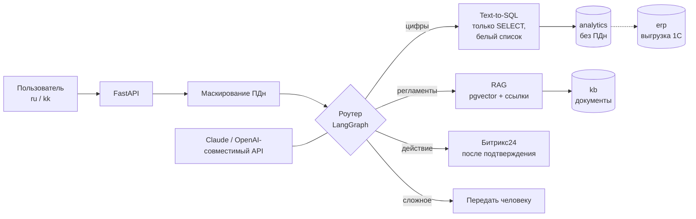

# ИИ-сотрудник для дистрибьютора

> **Демо-кейс для портфолио.** ТОО «Дала Дистрибьюшн» — вымышленная компания. Все данные (продажи,
> клиенты, ИИН/БИН, телефоны, договоры) синтетические и сгенерированы кодом из этого репозитория.

ИИ-сотрудник, с которым руководители и менеджеры дистрибьютора продуктов питания говорят на русском
или казахском:

- **«Сколько продали напитков в Алматы за октябрь и как это к прошлому году?»** — вопрос словами → безопасный SQL по выгрузке из 1С;
- **«Какая максимальная скидка для HoReCa без согласования?»** — ответ по регламентам со ссылкой на пункт документа, а если ответа нет — «не нашёл»;
- **«Поставь задачу Иванову позвонить клиенту с просрочкой»** — действие в Битрикс24 только после подтверждения;
- сложное или спорное — передаёт человеку.

## Статус

| Этап | Содержание | Статус |
|---|---|---|
| 1 | Структура репозитория, SQL-схема, генератор выгрузки «из 1С», документы для RAG | ✅ готово |
| 2 | Python-ядро: инструменты, граф LangGraph, API на FastAPI | ⏳ |
| 3 | Защита (маскирование ПДн, prompt injection, права SQL) и evals | ⏳ |
| 4 | TypeScript-дашборд: чат, трасса шагов агента, панель качества и стоимости | ⏳ |
| 5 | Docker, CI (GitHub Actions), деплой демо | ⏳ |

## Архитектура (целевая)



## Данные

Выгрузка «из 1С:Управление торговлей» за 01.01.2025–14.11.2026, дата выгрузки — 15.11.2026:
4 склада, 54 товара, 180 клиентов, 7 355 документов, 53 912 строк продаж, остатки по партиям,
дебиторка и планы продаж. В данных есть сезонность, возвраты, смена НДС 12% → 16% с 2026 года,
просроченные партии и заблокированные должники — подробно в [docs/data_model.md](docs/data_model.md).

Данные согласованы с документами: скидки в продажах не выходят за полномочия из политики скидок,
отсрочки и блокировки соответствуют кредитной политике, заказы не меньше минимальной суммы из
регламента отгрузки. Поэтому агент может отвечать на вопросы, где нужны и цифры, и правила
(«кому из должников уже должны были заблокировать отгрузки?»).

Восемь документов для RAG (регламенты, политики, договоры, памятка на казахском) лежат в
[data/documents](data/documents), письмо с prompt injection для тестов защиты —
в [data/documents_adversarial](data/documents_adversarial).

## Быстрый старт

```bash
cp .env.example .env          # заполните POSTGRES_PASSWORD и AGENT_DB_PASSWORD
make db-up                    # Postgres 16 + pgvector, схемы и демо-данные
make psql-agent               # консоль под ролью агента: только analytics, только чтение
```

```sql
SELECT doc_month, round(sum(amount_kzt) / 1e6, 1) AS выручка_млн
FROM sales WHERE doc_month >= '2026-08-01'
GROUP BY 1 ORDER BY 1;
```

Supabase или свой Postgres: укажите `DATABASE_URL` в `.env` и выполните `make db-apply`.

Перегенерировать данные и прогнать тесты:

```bash
make data && make test
```

## Структура

```
backend/
  src/dala_agent/demo_data/   генератор выгрузки «из 1С» (детерминированный)
  tests/                      инварианты данных и документов
db/
  sql/                        схемы erp, analytics, kb; роль agent_reader; загрузка CSV
  apply.sh                    применение к любой базе (docker init, Supabase)
data/
  demo_1c/                    CSV-выгрузка (синтетика)
  documents/                  регламенты и договоры для RAG
  documents_adversarial/      документы с prompt injection для evals
docs/data_model.md            модель данных и «ловушки» для text-to-SQL
```

## Стек

Python 3.12, PostgreSQL 16 + pgvector, pytest, ruff. Дальше по плану: LangGraph, FastAPI, Pydantic,
Claude (по умолчанию) или OpenAI-совместимый API под self-hosted модели, React + Vite + TypeScript.

## Лицензия

MIT
