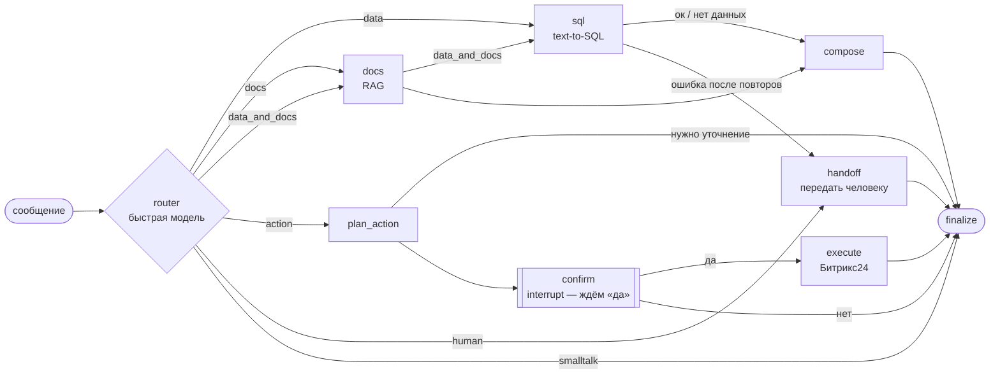

# Как устроен агент (этап 2)

Python-ядро: три инструмента, граф LangGraph и HTTP API. Код — `backend/src/dala_agent`.

## Граф



| Узел | Что делает |
|---|---|
| `router` | Классифицирует сообщение (с учётом истории: «а в прошлом году?», «Динаре») и определяет язык. Казахские буквы (ә, ғ, қ, ң, ө, ұ, ү, һ, і) надёжнее ответа модели. Модель недоступна → передача человеку |
| `sql` | Text-to-SQL: модель пишет SELECT → проверка → выполнение под `agent_reader`; ошибка проверки или базы уходит модели на исправление (по умолчанию 2 попытки) |
| `docs` | Гибридный поиск по `kb` → ответ только из найденных пунктов со ссылкой; без проверяемой ссылки — «не нашёл» |
| `compose` | Формулирует ответ по таблице результата (и правилам, если вопрос смешанный) |
| `plan_action` | Превращает просьбу в действие Битрикс24 и находит ответственного в справочнике сотрудников; при неоднозначности («Петренко» — их двое) спрашивает |
| `confirm` | `interrupt()`: граф останавливается, API возвращает `needs_confirmation` с текстом действия |
| `execute` | Выполняет подтверждённое действие (заглушка или вебхук) |
| `handoff` | Создаёт обращение для сотрудника (в заглушке — запись в журнал, в вебхуке — задача) |

Состояние диалога хранится чекпойнтером LangGraph (`InMemorySaver`; для нескольких процессов
нужен `PostgresSaver` — этап 5). Каждый узел пишет шаг в трассу: время, токены, SQL, найденные
фрагменты — это данные для панели на этапе 4.

## Рубежи защиты (уже в этапе 2)

**Text-to-SQL.**
1. `sql_guard`: ровно один SELECT; DML/DDL запрещены по всему дереву (включая CTE), `SELECT INTO`,
   `FOR UPDATE`, `SET`, `COPY`; источники — только 10 представлений `analytics` или CTE этого же
   запроса; служебные функции (`pg_*`, `lo_*`, `dblink`, `set_config`, `*_to_xml` …) запрещены;
   `LIMIT` ограничен сверху.
2. Выполняется не текст от модели, а SQL, заново собранный из проверенного дерева (без комментариев,
   с явной схемой `analytics.`) — нет расхождения между проверенным и выполненным.
3. База: роль `agent_reader` — только `USAGE` на `analytics`, read-only транзакция, `statement_timeout`.
   Интеграционные тесты проверяют, что даже без первого рубежа нельзя прочитать `erp`/`kb`, писать
   и держать запрос дольше 5 секунд.

**Документы и prompt injection.**
- Фрагменты подаются модели как данные: `<fragment … trust="internal|external">`, разметка внутри
  экранируется; промпт запрещает исполнять инструкции из фрагментов; при противоречии верен
  internal-документ.
- Ответ без ссылки на реально найденный пункт отбрасывается («не нашёл»).
- **Главное — по построению:** тексты документов и результаты SQL не попадают в планировщик
  действий. Действие в Битрикс24 может появиться только из сообщения пользователя и выполняется
  только после явного «да» в API (`/confirm` с `action_id` — устаревшее подтверждение не сработает,
  новое сообщение отменяет ожидающее действие).

Маскирование ПДн во входящих сообщениях и evals на эти сценарии — этап 3.

## Модели

| Назначение | По умолчанию | Альтернатива |
|---|---|---|
| Роутер | `claude-haiku-5-5` | любой OpenAI-совместимый API (`OPENAI_ROUTER_MODEL`) |
| SQL, ответы, действия | `claude-sonnet-5-5` | vLLM / Ollama / облако через `LLM_PROVIDER=openai` |
| Эмбеддинги (1024) | `hashing` — офлайн, без ключей | `bge-m3` через OpenAI-совместимый endpoint, `voyage-3.5` |

Структурированные ответы: у Claude — принудительный вызов инструмента со схемой Pydantic,
у OpenAI-совместимых — function calling, а если сервер его не поддерживает, JSON-режим со схемой
в промпте (снимаются `<think>` и ```json-обёртки self-hosted моделей).

`hashing`-эмбеддинги — лексический поиск в векторной форме: работают офлайн и в тестах, но синонимы
не ловят. При смене модели эмбеддингов индексатор пересчитывает векторы сам (`kb.documents.embedding_model`).

## API

```bash
make api   # http://127.0.0.1:8000/docs
```

```bash
curl -s localhost:8000/chat -H 'content-type: application/json' \
  -d '{"message": "Сколько продали напитков в Алматы за октябрь и как это к прошлому году?"}'

curl -s localhost:8000/chat -H 'content-type: application/json' \
  -d '{"thread_id": "demo", "message": "Поставь задачу Иванову позвонить клиенту с просрочкой"}'
# → "status": "needs_confirmation", "pending_action": {"action_id": "…", …}

curl -s localhost:8000/chat/demo/confirm -H 'content-type: application/json' \
  -d '{"approved": true, "action_id": "…"}'
```

Ответ: `answer`, `status` (`done` / `needs_confirmation` / `needs_clarification`), `route`,
`citations`, `sql` (запрос и строки), `pending_action`, `handoff`, `trace`, `usage`
(токены и стоимость, если в `.env` заданы цены за 1 млн токенов).

## Тесты

- `make test` — без сети и базы: проверка SQL (45 случаев), инструменты, граф на заглушках
  (подтверждение, отказ, устаревшее «да», уточнение ответственного, передача человеку),
  API, клиенты моделей на подменённом HTTP-транспорте.
- `make test-db` — на живом Postgres 16 + pgvector: права `agent_reader`, выполнение типичных
  запросов после пересборки, индексация и поиск нужного пункта по 5 вопросам (ru/kk),
  сквозной прогон графа с настоящими инструментами.
- Поведение реальных моделей (качество SQL, ссылок, отказов от injection) проверяется evals на этапе 3.
