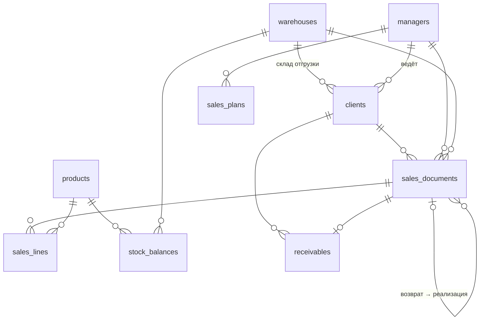

# Модель данных

Все данные синтетические: генератор `backend/src/dala_agent/demo_data/generator.py`, seed `20261117`.
Повторный запуск даёт побайтно те же CSV — на этом держатся эталонные ответы в evals.

## Три схемы

| Схема | Для кого | Что внутри |
|---|---|---|
| `erp` | загрузка, бэкенд | «Сырая» выгрузка из 1С, включая ПДн (ИИН ИП, контакты, телефоны) |
| `analytics` | **агент (text-to-SQL)** | Представления без ПДн: только проведённые документы, возвраты с минусом |
| `kb` | RAG | Документы и чанки с эмбеддингами (pgvector, `vector(1024)`) и полнотекстовым индексом |

Агент подключается ролью `agent_reader`: `USAGE` только на `analytics`, транзакции только на чтение,
`statement_timeout = 5s`. Это второй рубеж после проверки SQL в коде (только `SELECT`, белый список).

## Таблицы `erp`

| Таблица | Строк | Содержание |
|---|---:|---|
| `export_info` | 1 | Дата выгрузки 15.11.2026, период 01.01.2025–14.11.2026, пометка о синтетике |
| `warehouses` | 4 | Алматы ×2, Астана, Шымкент |
| `products` | 54 | 6 категорий, вымышленные бренды и поставщики |
| `managers` | 12 | Отдел продаж: РОП, региональные менеджеры, KAM, торговые представители |
| `clients` | 180 | Сеть 10, Опт 14, HoReCa 32, Розница 124; ТОО с БИН, ИП с ИИН |
| `sales_documents` | 7 355 | Реализации и возвраты, есть единичные непроведённые черновики |
| `sales_lines` | 53 912 | Количество, цена, скидка, НДС, себестоимость |
| `stock_balances` | 385 | Остатки по партиям со сроками годности |
| `receivables` | 169 | Открытые позиции дебиторки |
| `sales_plans` | 264 | План продаж по менеджерам на месяц (2025–2026) |

## Представления `analytics`

`sales` (построчно), `sales_documents`, `clients`, `products`, `managers`, `warehouses`,
`stock`, `receivables`, `plan_fact`, `export_info`. Описания колонок лежат в `COMMENT ON`
(их же получит модель как описание схемы).

## Что заложено в данные специально

Эти особенности делают text-to-SQL честной задачей и проверяются в evals:

1. **«Сегодня» = дата выгрузки** (`analytics.export_info.export_date` = 2026-11-15), а не `CURRENT_DATE`.
2. **Ноябрь 2026 — неполный месяц** (по 14.11): сравнение с октябрём требует оговорки.
3. **Возвраты** — отдельные документы; в `analytics.sales` уже с минусом, в `erp` — с плюсом.
4. **Непроведённые документы** есть в `erp`, в `analytics` отфильтрованы.
5. **НДС 12% → 16%** с 01.01.2026, цены 2026 года в среднем на 12% выше.
6. **Сезонность**: напитки — пик летом, кондитерка — декабрь и март (Наурыз), чай и консервы — зима.
7. **Рост** выручки около 10% за период, новые и ушедшие клиенты.
8. **Остатки**: дефицитные позиции (нет строки — нет остатка), партии с истекающим сроком,
   7 просроченных партий, не выведенных в карантин (регламент отгрузки п. 3.3: перемещение в течение
   одного рабочего дня — на дату выгрузки срок уже прошёл у 6 из них; макароны в Шымкенте просрочены с субботы 14.11).
9. **Дебиторка**: 6 клиентов с просрочкой > 15 дней заблокированы (кредитная политика п. 4.1),
   есть «хвосты» старше 90 дней (недоплаты не старше 150 дней — более старые к выгрузке закрыты).
10. **Согласованность с документами**: скидки не выходят за полномочия менеджера по сегменту,
    отсрочки и лимиты соответствуют кредитной политике, сумма заказа не ниже минимальной.

## Документы базы знаний

| Файл | Тип | Язык |
|---|---|---|
| `01_reglament_otgruzki.md` | Регламент приёма заказов, отгрузки и доставки | ru |
| `02_kreditnaya_politika.md` | Кредитная политика и дебиторка | ru |
| `03_politika_skidok.md` | Ценообразование и скидки | ru |
| `04_vozvraty_i_pretenzii.md` | Возвраты и претензии | ru |
| `05_dogovor_postavki_tipovoy.md` | Типовой договор поставки | ru |
| `06_distribyutorskiy_dogovor_zhemis.md` | Дистрибьюторский договор с поставщиком (выдержки) | ru |
| `07_polozhenie_pdn.md` | Положение о персональных данных | ru |
| `08_zhadynama_sauda_okilderine.md` | Памятка торговым представителям | kk |
| `documents_adversarial/01_…` | Письмо поставщика с prompt injection (для тестов) | ru |

Пункты в документах пронумерованы (`4.1.`), чтобы агент мог ссылаться на конкретный пункт.
